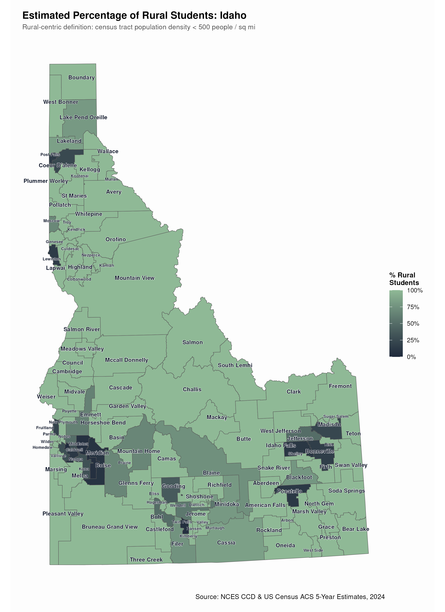

# US School District Rurality & Math Achievement Explorer

**Block-Dasymetric Demographic, Spatial Remoteness, Fiscal & Economic Analysis for ~13,300 US Public School Districts**

[**Launch Interactive Map**](https://joemathed.github.io/us-district-rurality/) · [**Methodology & Validation**](#-methodology--validation-benchmarks) · [**Repository Structure**](#-repository-architecture) · [**Run on HPC**](#-borah-hpc--slurm-execution) · [**Cite This Project**](#-citation)

---

<p align="center">
  <a href="https://joemathed.github.io/us-district-rurality/">
    
  </a>
  <br />
  <em>Example state-level output: Block-dasymetric share of school-aged youth (ages 5–17) in low-density census tracts (&lt; 500 people/sq mi) across Idaho's geographically bounded school districts. <a href="https://joemathed.github.io/us-district-rurality/">Explore all 50 states + DC interactively &rarr;</a></em>
</p>

---

## Overview

Traditional school district rurality classifications rely on single categorical codes (such as NCES urban-centric locales) or raw polygon area overlays that distort districts spanning both small towns and vast uninhabited public lands.

This repository implements an end-to-end, containerized **R geospatial pipeline** and **zero-backend interactive web application** that measures rurality continuously across every geographically bounded US school district (`agency_type` 1, 2, and 7). By combining **Census ACS 5-year school-aged estimates (ages 5–17)** with **2020 Decennial Census block interior points (~8.13 million blocks)**, the pipeline isolates where school-aged youth actually live and pairs those estimates with spatial remoteness, district finance, local economic structure, and Grade 3, 5, and 8 mathematics achievement.

## Live Interactive Web Explorer

Hosted statically on GitHub Pages at [**joemathed.github.io/us-district-rurality**](https://joemathed.github.io/us-district-rurality/) using Leaflet, simplified EPSG:5070 $\rightarrow$ WGS84 GeoJSON (`COORDINATE_PRECISION=5`), and decoupled JSON assessment tables:

* **Multi-Metric Choropleth & Filtering**: Switch dynamically between four continuous indicators—**Tract Density (**$<500\text{ people/mi}^2$**)**, **Outside Census Urban Areas**, **USDA ERS 2020 RUCA Rural (Codes 7–10)**, and **USDA ERS 2020 RUCA Nonmetro (Codes 4–10)**—with quick-filter threshold pills ($\ge 50\%$, $\ge 75\%$, $100\%$), continuous sliders, and 5-tier bin views.

* **NCES Locale Divergence Highlighting**: Flags districts where categorical NCES urban-centric locales diverge from block-dasymetric youth rurality (e.g., *City/Suburb* districts serving $\ge 15\%$ rural youth, *Town* districts serving $\ge 50\%$ rural youth, or *Rural* districts with $<50\%$ rural youth).

* **Comprehensive District Profile Drawer**:

  * **Youth Rurality Breakdown**: Estimated rural vs. non-rural youth (ages 5–17), state and national percentile ranks, and locale divergence callouts.

  * **Spatial Rurality & Remoteness**: Share of youth outside Census Urban Areas, RUCA Rural (`7–10`), Town/Micro (`4–6`), and Nonmetro (`4–10`) shares, plus planar distance (miles) from each district's population-weighted centroid to the nearest Urban Area and $\ge 50,000$-population Urbanized Area.

  * **District Finance & Local Economy**: Per-pupil total revenue, local revenue share, current operating expenditure, **CWIFT-adjusted expenditure**, **Comparable Wage Index for Teachers (CWIFT)**, SAIPE child poverty, block-apportioned median household income, ACS poverty rate, workplace agriculture/forestry and manufacturing job shares (LEHD LODES8), and district commute self-containment.

  * **Two-Tier Grade 3, 5 & 8 Math Proficiency**: Stacked proficiency distributions combining national EDFacts baselines with 4-level state report card overrides (e.g., Idaho ISAT).

* **Linked Visualizations & Deep Linking**: Interactive **Rurality** $\times$ **Math** SVG scatterplot modal, context-aware **300 DPI state map** viewer, built-in **Metrics & Methodology Guide**, and shareable URL query parameters (`?state=ID&district=1600002`).

## Data Sources & Indicators

| Analytical Domain | Primary Datasets & R Packages | Key District-Level Metrics (`GEOID` Key) |
| :--- | :--- | :--- |
| **Core Youth Rurality** | US Census ACS 5-Year (`tidycensus` Tables `B01001`, `B09001`), 2020 Decennial Blocks (`P1_001N`, `H1_001N`), TIGER/Line (`tigris`), NCES CCD (`educationdata`) | `pct_pop_rural` ($<500/\text{mi}^2$), `est_total_pop_5_17`, `est_rural_pop_5_17`, `weighted_mean_density`, `urban_centric_locale_type` |
| **Spatial Remoteness** | TIGER/Line Census Urban Areas (`tigris::urban_areas()`), USDA ERS 2020 Tract RUCA Codes | `pct_youth_outside_ua`, `pct_youth_ruca_rural` (7–10), `pct_youth_ruca_nonmetro` (4–10), `dist_any_ua_mi`, `dist_50k_ua_mi` |
| **School District Finance** | NCES CCD F-33 Survey, SAIPE Child Poverty & NCES CWIFT (`edfinr`) | `rev_total_pp`, `pct_rev_local`, `pct_rev_state`, `pct_rev_fed`, `exp_cur_pp`, `exp_cur_cwift_pp`, `cwift_est`, `saipe_stpov_pct` |
| **Local Economic & Commute Mix** | Census ACS 5-Year (`B19013`, `B17001`, `B23025`, `C24030`) & LEHD LODES8 Block WAC/OD (`lehdr`) | `est_med_hh_inc`, `acs_poverty_pct`, `acs_unemp_pct`, `res_pct_ag_mining`, `work_pct_ag_for`, `work_pct_mfg`, `commute_self_contain_pct` |
| **Math Achievement** | National EDFacts (`educationdata`) & State DOE Report Cards (`data_raw/state_assessments/`) | Grade 3, 5, and 8 proficiency distributions (`math_assessments.json`) with privacy suppression notes |

## Methodology & Validation Benchmarks

### 1. Block-Dasymetric Youth Apportionment vs. Areal Weighting

Apportioning tract-level populations by raw polygon area introduces severe boundary artifacts when rural tracts span mountains, rangelands, or urban fringes. Validated against actual NCES CCD K–12 enrollment across Idaho's 115 bounded school districts (`src/benchmark_idaho_rurality.R`), combining **ACS Table B09001 (ages 5–17)** with **2020 Decennial Census block weights** reduced Mean Absolute Percentage Error (MAPE) by **77.7%**:

| Estimation Model | RMSE (Students) | MAE (Students) | MAPE (%) | Median APE (%) | Spearman $\rho$ |
| :--- | :---: | :---: | :---: | :---: | :---: |
| **M0: Area-Weighted Total Pop (Scaled 5–17)** | 1,985.2 | 824.5 | 148.62% | 35.02% | 0.9169 |
| **M1: Area-Weighted ACS Ages 5–17** | 1,568.2 | 655.0 | 116.00% | 27.91% | 0.9325 |
| **M2: Block-Dasymetric Total Pop (Scaled 5–17)** | 1,972.0 | 798.7 | 45.45% | 26.89% | 0.9593 |
| **M3: Block-Dasymetric ACS Ages 5–17 (Production)** | **1,571.6** | **632.6** | **33.13%** | **22.28%** | **0.9736** |

### 2. Multi-Dimensional Rurality, Finance & Economic Structure (Idaho Benchmark, $n = 115$)

Prototyped via `src/benchmark_idaho_ext3.R` and `src/benchmark_idaho_ext1_ext2.R` prior to national deployment:

| NCES Locale Category | Districts | Mean % Rural ($<500/\text{mi}^2$) | Mean % Outside UA | Mean % RUCA Rural (7–10) | Median Rev / Pupil | Median CWIFT Index | Median Ag/For Jobs |
| :--- | :---: | :---: | :---: | :---: | :---: | :---: | :---: |
| **1: City** | 6 | 16.4% | 7.8% | 0.0% | \$11,683 | 0.858 | 0.4% |
| **2: Suburb** | 7 | 26.0% | 14.1% | 0.0% | \$10,711 | 0.851 | 1.1% |
| **3: Town** | 20 | 71.5% | 43.4% | 11.2% | \$11,023 | 0.807 | 4.8% |
| **4: Rural** | 82 | 98.7% | 99.9% | 58.6% | \$15,121 | 0.785 | 14.6% |

*(Note: While nominal per-pupil revenue and spending are higher in rural districts due to sparsity funding and fixed operating overhead, `cwift_est` and median household income correlate negatively with rurality and distance to* $\ge 50\text{k}$ *urban cores.)*

## Repository Architecture

To respect HPC home directory quotas, tracked source code and lightweight web assets live in `~/us-district-rurality`, while multi-gigabyte spatial caches, raw shapefiles, and Slurm logs are segregated into `/bsuscratch/$USER/district-rurality/`:

```text
us-district-rurality/
├── src/
│   ├── 01_fetch_rurality_data.R          # Stage 1: Year probing, ACS, TIGER, CCD, Blocks, Urban Areas, RUCA, edfinr & LODES8
│   ├── 02a_compute_spatial_metrics.R     # Stage 2A: Parallel block-dasymetric joins & Ext #1–#3 metric computation
│   ├── 02b_render_state_maps.R           # Stage 2B: Parallel 300 DPI UTM-projected state choropleth PNG rendering
│   ├── 03_export_web.R                   # Stage 3A: EPSG:5070 simplification, percentile ranks & GeoJSON/metadata export
│   ├── 04_fetch_and_clean_assessments.R  # Stage 3B: Two-tier EDFacts + state report card math proficiency JSON export
│   ├── benchmark_idaho_rurality.R        # Validation benchmark: Area-weighted vs. block-dasymetric enrollment accuracy
│   ├── benchmark_idaho_ext3.R            # Validation benchmark: Urban Areas, 2020 RUCA & urban core distances
│   ├── benchmark_idaho_ext1_ext2.R       # Validation benchmark: edfinr F-33/CWIFT, ACS C24030 & LEHD LODES8
│   ├── parsers/
│   │   └── parse_idaho_isat.R            # Tier 2 state report card parser for 4-level Idaho ISAT math data
│   └── utils/
│       └── district_name_helpers.R       # Shared LEA name cleaning & abbreviation helpers
├── slurm/
│   ├── 01_fetch.sbatch                   # Slurm job script for Stage 1 data fetch & caching
│   ├── 02a_spatial.sbatch                # Slurm job script for Stage 2A spatial computation
│   ├── 02b_maps.sbatch                   # Slurm job script for Stage 2B 300 DPI map rendering
│   └── 03_web_data.sbatch                # Slurm job script for Stage 3 web GeoJSON & assessment JSON export
├── data_raw/
│   ├── RUCA-codes-2020-tract.csv         # Tracked USDA ERS 2020 Census Tract RUCA classification table
│   └── state_assessments/                # Tracked standardized Tier 2 state assessment CSV overrides
└── docs/                                 # GitHub Pages static web root
    ├── index.html                        # Zero-backend Leaflet + SVG interactive explorer
    ├── data/
    │   ├── districts_poc.geojson         # Simplified national school district boundaries & all indicators
    │   ├── rurality_meta.json            # Pipeline vintage & methodology metadata
    │   └── math_assessments.json         # Keyed Grade 3, 5 & 8 math proficiency distributions
    └── maps/labeled/                     # 51 compressed 300 DPI labeled state choropleth PNGs (<st>.png)
```

## Borah HPC & Slurm Execution

The pipeline executes inside an Apptainer container (`rocker/geospatial:4.4.2`) with supplemental R libraries (`tigris`, `tidycensus`, `ggrepel`, `educationdata`, `edfinr`, `lehdr`, `viridis`, `furrr`) mounted from `/bsuscratch/$USER/R_libs`.

### Prerequisites

1. Register a US Census API key in `~/.Renviron` (`CENSUS_API_KEY="..."`).

2. Provision scratch directories and container image:

   ```bash
   mkdir -p /bsuscratch/$USER/district-rurality/{data_cache,outputs,logs} /bsuscratch/$USER/{containers,R_libs}
   ```

### Common Execution Workflows

* **Full Chained Pipeline (Data Check** $\rightarrow$ **Spatial Metrics** $\rightarrow$ **Maps & Web Export)**:

  ```bash
  cd ~/us-district-rurality && git pull && J1=$(sbatch --parsable slurm/01_fetch.sbatch) && J2A=$(sbatch --dependency=afterok:$J1 --parsable slurm/02a_spatial.sbatch) && sbatch --dependency=afterok:$J2A slurm/02b_maps.sbatch && sbatch --dependency=afterok:$J2A slurm/03_web_data.sbatch
  ```

* **Recompute Metrics & Refresh Web Assets (Using Cached Raw Data)**:

  ```bash
  cd ~/us-district-rurality && git pull && J2A=$(sbatch --parsable slurm/02a_spatial.sbatch) && sbatch --dependency=afterok:$J2A slurm/02b_maps.sbatch && sbatch --dependency=afterok:$J2A slurm/03_web_data.sbatch
  ```

* **Web JSON & Assessment Export Only (~45 seconds)**:

  ```bash
  cd ~/us-district-rurality && git pull && sbatch slurm/03_web_data.sbatch
  ```

## Citation

If you use the datasets, spatial pipeline, or web explorer in research or policy work, please cite:

```bibtex
@misc{champion2026rurality,
  author       = {Champion, Joe},
  title        = {US School District Rurality \& Math Achievement Explorer: Block-Dasymetric Demographic, Spatial Remoteness, Fiscal, and Economic Analysis},
  year         = {2026},
  publisher    = {GitHub},
  journal      = {GitHub repository},
  howpublished = {\url{https://github.com/JoeMathEd/us-district-rurality}},
  note         = {Interactive web explorer: \url{https://joemathed.github.io/us-district-rurality/}}
}
```

## Author & Acknowledgments

**Joe Champion** · Boise State University

Data sources include the **US Census Bureau** (ACS 5-Year, 2020 Decennial Census, TIGER/Line, SAIPE), **National Center for Education Statistics (NCES)** (Common Core of Data, F-33 School District Finance, CWIFT), **USDA Economic Research Service** (2020 RUCA Codes), **US Department of Education** (EDFacts), and **Idaho State Department of Education**. Special thanks to the [`edfinr`](https://cran.r-project.org/package=edfinr), [`lehdr`](https://github.com/jamgreen/lehdr), [`tidycensus`](https://walker-data.com/tidycensus/), and [`educationdata`](https://github.com/UrbanInstitute/education-data-package-r) open-source R communities.